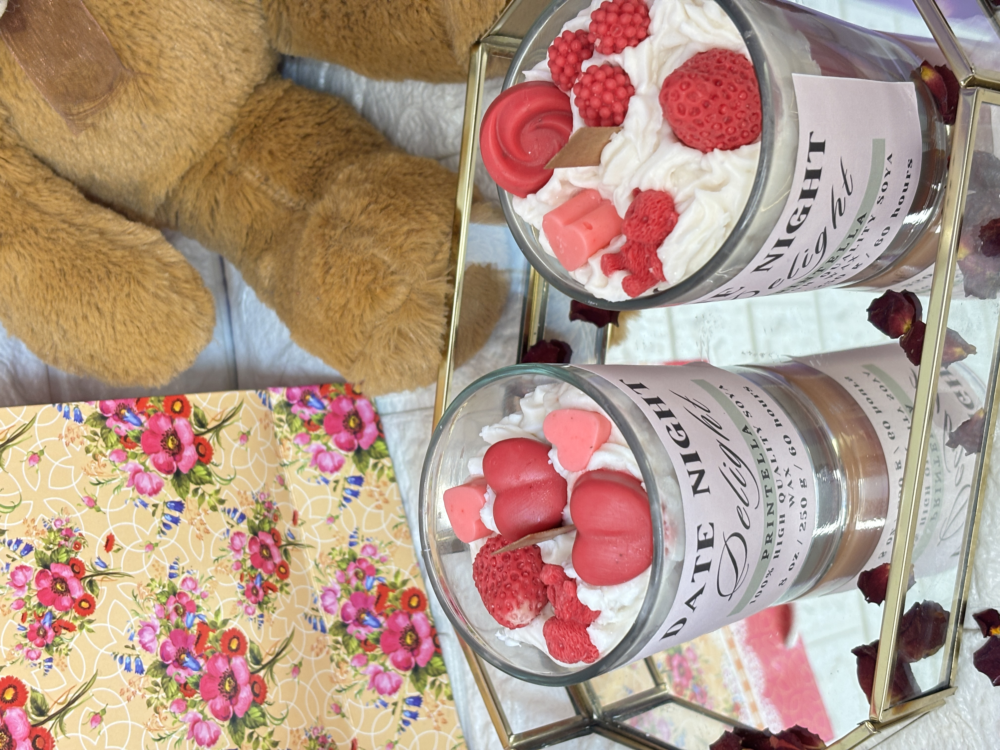

# 01 — Business Overview

## About Printella

Printella is a D2C scented candle and lifestyle brand founded in 2022.

The business was built around creating aromatic candles, wax melts and curated gifting products, with an emphasis on product presentation, fragrance and customer experience.

I founded Printella and took responsibility for developing and operating the business across its major functions.

## The Business

**Business:** Printella  
**Category:** D2C / Consumer Products / Home Fragrance  
**Founded:** 2022  
**Business model:** Direct-to-consumer and gifting  
**Products:** Scented candles, wax melts and gift boxes  
**Online presence:** Shopify and Instagram

## What I Built

I worked across the complete business lifecycle:

- Developed the brand identity and product positioning.
- Researched and developed products and fragrance combinations.
- Managed raw material sourcing and supplier coordination.
- Worked on product costing, pricing and packaging.
- Managed inventory, production and order fulfilment.
- Developed social media and digital marketing strategies.
- Explored corporate gifting and partnership opportunities.
- Managed customer-facing sales and business operations.

## Milestones

- Built a consumer brand from the ground up.
- Sold more than 1,000 products.
- Secured corporate sponsorships from Starbucks and Domino's for college events.
- Developed an online storefront and social media presence.
- Managed product development, sourcing, marketing and fulfilment.
 

## Business Links

- Website: https://printella-candles.myshopify.com/
- Instagram: https://www.instagram.com/printella.art/

## My Role

**Founder & CEO**

I was responsible for taking the business from an initial concept to an operating consumer brand, making decisions across product development, branding, marketing, operations and business development.

---

*This document is part of my ongoing documentation of building Printella.*
