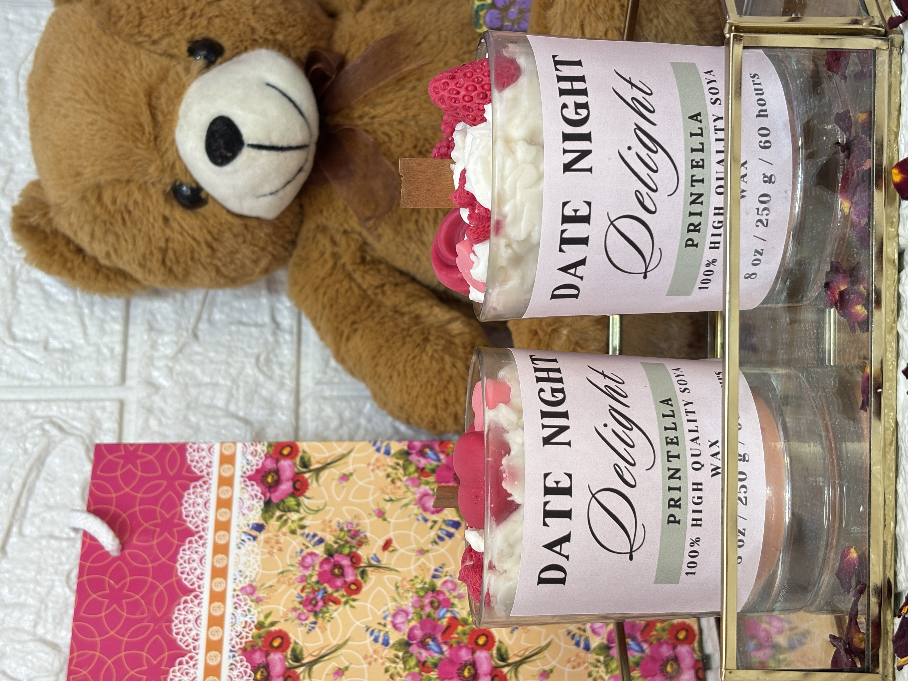
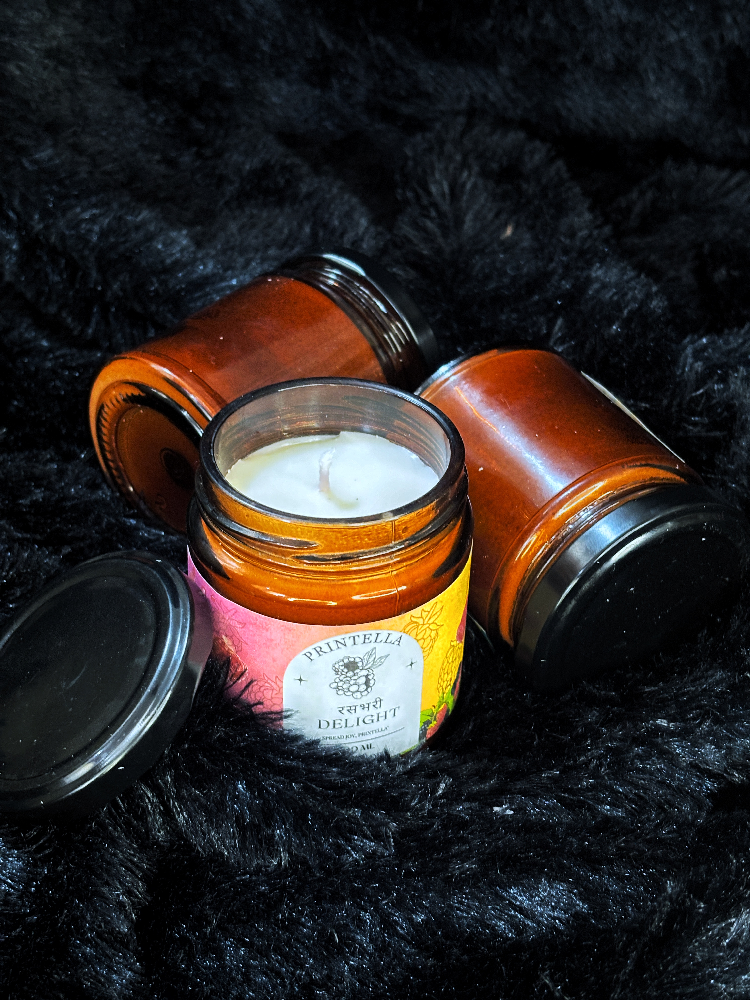

# PRINTELLA — Portfolio Continuation

This document continues the existing Printella portfolio after `01-business-overview.md` and `02-brand-and-product-development.md`. It covers operations, commercial thinking, marketing, business development and lessons from building the business.

## 03 — Operations & Supply Chain

### Running production

Printella used a hands-on production model. I personally made the candles, taking them from material and fragrance experimentation through production and preparation for fulfilment.

My operating responsibilities included sourcing raw materials, coordinating with suppliers, managing inventory, producing the products, preparing orders and arranging fulfilment. This gave me direct involvement in the practical work behind a consumer-products business, from material decisions to the finished customer order.

### Starting capital

I reported an initial investment of approximately **₹50,000** to start Printella. This is the initial amount, not a verified total of all investment over the life of the business. The available record does not break it down by materials, equipment, packaging, branding, website or other costs.

### Quality and fulfilment

Product development included testing wax mixtures, fragrance proportions, burn performance and consistency. Making the candles myself connected those product experiments with actual production and preparation for sale.

The current record does not specify supplier names, batch sizes, production capacity, a formal quality checklist, shipping partners or delivery times, so this document does not make claims about them.

## 04 — Pricing & Unit Economics

Pricing required balancing affordability, the value customers saw in the product and the economics of making and selling it. The factors considered included:

- Wax and fragrance oil costs.
- Packaging and labelling.
- The hands-on work involved in manufacturing.
- Product presentation and brand positioning.
- Customer expectations and alternatives in the market.
- Selling and fulfilment expenses.

The portfolio materials do not contain verified product-level costs, selling prices, margins, revenue or lifetime investment totals. I have left those figures out rather than estimate them.

## 05 — Marketing & Customer Acquisition

Printella built an online presence through a Shopify storefront and Instagram. I worked on the brand's social media and digital marketing strategy, content and customer-facing presentation.

The portfolio records sales of **more than 1,000 products**. The available information does not attribute those sales to a particular channel or include verified follower growth, advertising spend, campaign performance, conversion rates or customer acquisition costs. This document therefore describes the channels and work without assigning unsupported results to them.

**Online presence**

- Shopify: https://printella-candles.myshopify.com/
- Instagram: https://www.instagram.com/printella.art/

## 06 — Partnerships & Business Development

I secured corporate sponsorships from **Starbucks** and **Domino's** for college events. This experience added business-development work to my responsibilities as a founder and gave me exposure to arranging commercial support around event opportunities.

The current record does not include sponsorship values, event names, agreement terms or outcome metrics, so I have not added details beyond the confirmed sponsorships.

## 07 — Challenges, Experiments & Lessons

### Changing the original business idea

Printella was first conceived as a clothing brand. After considering the capital needed to enter fashion, I decided that starting a clothing business would require more investment than I wanted to make. I wanted to build independently using personal savings, so I adapted the idea and launched Printella as a scented candle brand under the same name.

That change let me move forward with a more manageable starting investment while retaining ownership of the venture. It became a practical lesson in adjusting a business model to fit available resources instead of abandoning the wider goal of building a business.

### Learning through execution

Building Printella involved learning across product, brand and operations at the same time. Developing new candle formats, experimenting with fragrance combinations, testing product performance, making the products and preparing them for customers connected creative decisions with manufacturing and commercial considerations.

The experience developed my ability to:

- Make decisions with limited resources.
- Adapt a business idea when its original form is not practical to fund.
- Carry a consumer product from concept through hands-on production.
- Consider product quality, presentation, cost and customer experience together.
- Take responsibility across product development, operations, marketing and business development.

---

*This continuation records the work and outcomes currently supported by the portfolio materials and project conversation. Financial and operating metrics that have not been verified are intentionally omitted.*
